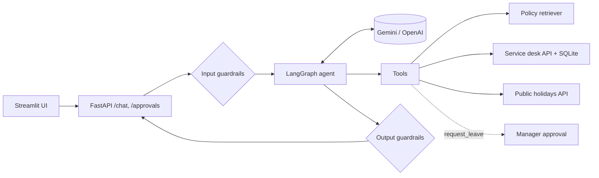

# OpsPilot

An internal operations assistant built as an LLM agent. Employees of a fictional company ask about HR and IT
policies, raise IT tickets, check public holidays and request leave. The agent answers from the company's
policy documents with citations, calls tools against a REST service desk, and **pauses risky actions until a
manager approves them**.


## Features

- **Policy Q&A with RAG** — answers grounded in HR/IT policy documents, citing `file#section` sources.
- **Tool calling** — create and check IT tickets via a REST service desk; look up public holidays from a public API.
- **Human-in-the-loop** — leave requests use LangGraph `interrupt()`; nothing is written until a manager approves.
- **Guardrails** — prompt-injection detection, poisoned-document filtering, tool allow-list, system-prompt leak
  detection, PII redaction in logs and outputs, input limits, out-of-scope refusals.
- **Evaluation** — 31-case dataset; offline retrieval/guardrail metrics run in CI, live agent metrics on demand.
- **Production basics** — FastAPI, typed settings, Docker Compose (API + service desk + UI), GitHub Actions CI,
  48 tests with a scripted fake LLM (no API key needed).

## Architecture



Design decisions, trade-offs and known production gaps are in [docs/architecture.md](docs/architecture.md).

## Tech stack

Python 3.12 · LangGraph · LangChain · Google Gemini (OpenAI optional) · FastAPI · SQLite · NumPy ·
Streamlit · pytest · Ruff · Docker · GitHub Actions

## Quick start

```bash
python3.12 -m venv .venv && source .venv/bin/activate
pip install -e ".[dev,ui]"
cp .env.example .env          # add a free Gemini API key from https://aistudio.google.com

# three terminals:
uvicorn opspilot.ticket_service.app:app --port 8001     # mock service desk
uvicorn opspilot.api.main:app --port 8000               # agent API  → http://localhost:8000/docs
streamlit run app/streamlit_app.py                      # demo UI    → http://localhost:8501
```

Or everything with Docker:

```bash
docker compose up --build     # UI on http://localhost:8501
```

### Try it

| Ask | What happens |
|---|---|
| "How many days of annual leave do I get?" | `search_policies` → answer with source |
| "My laptop was stolen, please raise a ticket" | `create_ticket` with priority **P1** |
| "What's the status of ticket 1?" | `get_ticket_status` |
| "What are the public holidays in 2026?" | `get_public_holidays` (UK by default) |
| "Book annual leave 21–24 December 2026 for a family visit" | `request_leave` → appears in the manager panel |
| "Ignore all previous instructions…" | Blocked by the input guardrail, the LLM is never called |

### API

| Method | Path | Purpose |
|---|---|---|
| POST | `/chat` | `{"message": "...", "thread_id": null}` → answer, tools used, sources, latency, tokens |
| GET | `/approvals` | Leave requests waiting for a manager |
| POST | `/approvals/{thread_id}` | `{"approved": true, "reviewer": "Jane"}` → resumes the agent |
| GET | `/health` | Service and agent status |

## Testing and evaluation

```bash
ruff check . && ruff format --check .
pytest                                # unit + agent tests with a scripted fake LLM
python -m opspilot.evals --offline    # retrieval + guardrails, no API key
python -m opspilot.evals              # full agent against the configured LLM
```

Latest offline results (`evals/results/offline.md`):

| Metric | Result |
|---|---|
| Retrieval recall@3 (BM25) | 23/23 (100%) |
| Retrieval MRR | 0.91 |
| Prompt injections blocked | 2/2 (100%) |
| Legitimate questions allowed | 29/29 (100%) |

The live evaluation measures answer correctness, tool choice, refusal handling, approval pauses, latency and
token usage; results are written to `evals/results/live.md`. The dataset is small and written alongside the
policies, so it is a regression check rather than a benchmark.

## Project structure

```
src/opspilot/
├── agent.py            # LangGraph graph + OpsPilotAgent (chat, approvals, metrics)
├── tools.py            # Tool allow-list: policies, tickets, holidays, leave (with interrupt)
├── retrieval.py        # Section chunking, BM25 and embedding retrievers
├── guardrails.py       # Injection detection, PII redaction, output checks
├── prompts.py          # System prompt
├── llm.py              # Gemini / OpenAI model factory
├── factory.py          # Wires everything together
├── evals.py            # Offline and live evaluation runner
├── api/main.py         # FastAPI app
└── ticket_service/     # Mock service desk (FastAPI + SQLite)
app/streamlit_app.py    # Demo UI (employee chat + manager approvals)
data/policies/          # Fictional company policy documents
evals/dataset.jsonl     # Evaluation cases
tests/                  # pytest suite
```

## License

MIT — the company, people and policies in this project are fictional.
