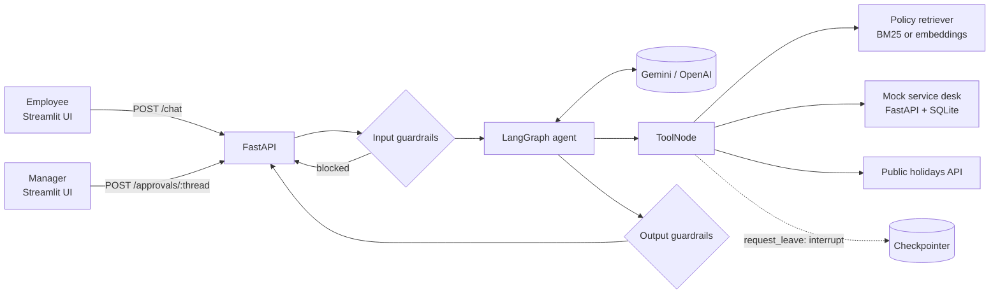

# Architecture and design decisions

## Overview

## Request flow

1. `POST /chat` receives a message and an optional `thread_id`.
2. **Input guardrails** reject empty, over-long and prompt-injection inputs before any LLM call.
3. The **LangGraph** graph runs `agent → tools → agent …` until the model answers without calling a tool
   (bounded by `max_agent_steps`).
4. Tools are a fixed allow-list: `search_policies`, `create_ticket`, `get_ticket_status`,
   `get_public_holidays`, `request_leave`. Tool arguments are validated by their type hints / Pydantic.
5. `request_leave` calls LangGraph's `interrupt()`. The graph state is saved in the checkpointer and the API
   returns `pending_approval`. A manager calls `POST /approvals/{thread_id}`; the graph resumes with
   `Command(resume=decision)` and only then writes to the service desk.
6. **Output guardrails** block system-prompt leakage (canary token) and redact card / national ID numbers.
7. The response includes tools used, cited sources, latency and token usage.

## Design decisions and trade-offs

| Decision | Why | Trade-off / next step |
|---|---|---|
| LangGraph instead of a hand-written loop | Explicit state machine, built-in checkpointing and `interrupt()` for human-in-the-loop | Extra dependency; a plain loop would be simpler for a single tool |
| BM25 as default retriever, embeddings optional | Small corpus; deterministic, free, testable offline, good on exact policy terms | Weaker on paraphrases — switch `OPSPILOT_RETRIEVER=embeddings`, or use hybrid search at scale |
| Section-level chunks | Policy sections are short and self-contained, so citations point to a precise section | Long sections would need splitting with overlap |
| Regex-based guardrails | Fast, transparent, zero cost, easy to test | Can be bypassed by paraphrasing — add an LLM or classifier-based check in production |
| Human approval for leave | Writes that affect people or money should not be fully autonomous | Approval state is in memory; use a persistent checkpointer (Postgres/Redis) in production |
| Mock service desk over REST | Exercises real integration concerns (HTTP errors, 404s, validation) | Replace with ServiceNow / Jira APIs and OAuth |
| Scripted fake LLM in tests | Agent logic is tested deterministically in CI without API keys or cost | Model quality is measured separately by the live eval |

## Evaluation

* **Offline (CI):** retrieval recall@3 and MRR on 23 policy questions; injection block rate and false-positive
  rate on all 31 questions.
* **Live:** full agent against the real model — answer correctness, tool choice, refusal handling, approval
  pauses, latency and token usage. Run with `python -m opspilot.evals`.

The dataset is small and was written alongside the policy documents, so scores are optimistic; it is meant to
catch regressions, not to benchmark models.

## Production gaps (known)

* In-memory checkpointer and pending-approval store → persistent storage.
* No authentication → SSO (OIDC) with the employee and manager identities passed to tools.
* No rate limiting or streaming responses.
* Observability: structured logs exist with PII redaction; add tracing (OpenTelemetry / LangSmith).
